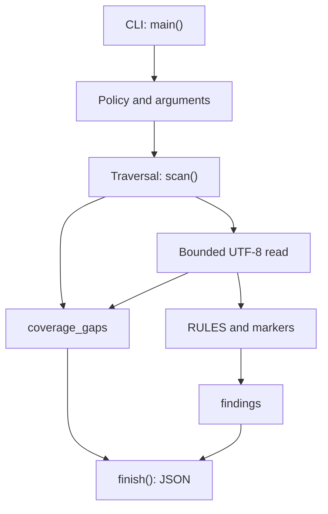

# Implementation architecture

## Components

`main()` parses arguments, reads policy and validates `markers`. `scan()` receives a directory, markers and limits; `private_v4()` refines address matches; `finish()` creates the report. The core is currently one `guard.py` file; there is no plugin system or separate adapters.

## Data flow

1. Validate an existing nonsymlink root directory, then obtain its absolute path using `resolve()`.
2. Traverse with `os.walk(..., followlinks=False)`. Sort names; remove symlink directories from traversal and record gaps.
3. Record `.git` and `__pycache__` exclusions. Count every encountered file, including unsupported files. Directory budget includes the root; excessive immediate fanout stops before processing child paths, conservatively including excluded and symlink children.
4. Skip symlink files and unknown extensions. Open supported files with `O_RDONLY` and, where available, `O_NOFOLLOW` and `O_NONBLOCK`.
5. `fstat()` verifies a regular file. Read at most the smaller of `max_bytes + 1` and remaining aggregate budget; count bytes even for invalid input. Compare file size with remaining budget; incomplete input is not scanned. Reject oversize/NUL/invalid UTF-8.
6. Cache newline positions once per file; binary search supplies each line number. A further valid match beyond `max_findings` stops traversal without retaining that match.
7. Serialize using `ensure_ascii=False`, `indent=2`; findings take exit-code priority over gaps.

## Errors and trust boundaries

Paths, file contents and policy are untrusted. Text is never executed. File errors create gaps without stopping remaining files. Exhausting a global resource budget ends traversal. Root/policy errors produce a different short error object.

`O_NOFOLLOW` protects the final path component on supporting operating systems; its absence and concurrent parent-directory replacement limit protection. This is not a complete filesystem sandbox.

## Performance

Byte and finding budgets bound those quantities, not total process memory or runtime. `os.walk` allocates immediate entry lists before the fanout check. Report records and newline positions remain in memory. Throughput and maximum working set have not been benchmarked.

## Development direction

Separating the scanner loader, pure checks and serialization is planned; response contract validation is delivered separately. This is a target architecture, not a claim that those modules exist. Changes must retain errors and must never convert missing data into success.

## Report consumer boundary

`validate_report.py` reads a bounded regular report, checks UTF-8/strict JSON/depth, validates local Draft 2020-12 structure and then applies producer invariants. It serializes a small validation result without input values. `asset_id` remains an opaque label; the consumer never reopens source files. External schema retrieval is denied. Optional dependencies are confined to validation; scanner execution remains standard-library-only.

`check_docs.py` validates paired pages and local links, executes synthetic examples and validates their emitted reports. CI installs the optional environment, checks dependencies, runs 37 tests and then documentation checks on three hosted OS runners.

---

[Documentation index](index.md) · [Русский](../ru/architecture.md)
