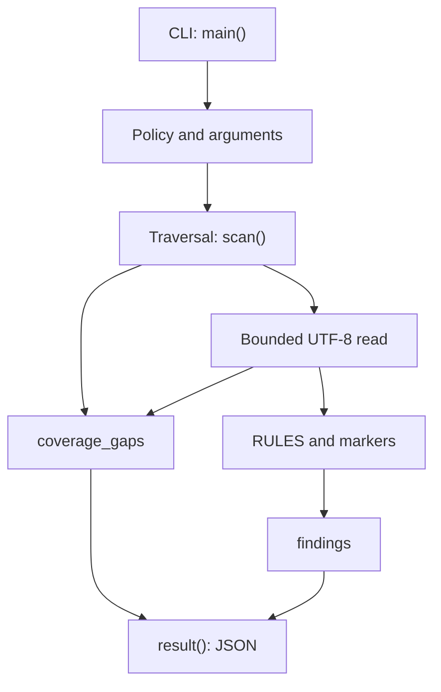

# Implementation architecture

## Components

`main()` parses arguments, reads policy and validates `markers`. `scan()` receives a directory, markers and limits; `private_v4()` refines address matches; `result()` creates the report. The core is currently one `guard.py` file; there is no plugin system or separate adapters.

## Data flow

1. Validate an existing nonsymlink root directory, then obtain its absolute path using `resolve()`.
2. Traverse with `os.walk(..., followlinks=False)`. Sort names; remove symlink directories from traversal and record gaps.
3. Remove `.git` and `__pycache__` without recording a gap. Each encountered file increments the count, including unsupported files.
4. Skip symlink files and unknown extensions. Open supported files with `O_RDONLY` and, where available, `O_NOFOLLOW` and `O_NONBLOCK`.
5. Check regular-file status with `fstat()`. Read up to `max_bytes + 1` to detect excess size. Reject NUL; decode remaining bytes as UTF-8.
6. Rules and markers create separate findings. Count preceding `\n` characters to obtain the line number.
7. Serialize using `ensure_ascii=False`, `indent=2`; findings take exit-code priority over gaps.

## Errors and trust boundaries

Paths, file contents and policy are untrusted. Text is never executed. File errors create gaps without stopping remaining files. Exceeding the file count ends traversal. Root/policy errors produce a different short error object.

`O_NOFOLLOW` protects the final path component on supporting operating systems; its absence and concurrent parent-directory replacement limit protection. This is not a complete filesystem sandbox.

## Performance

Each read is bounded, but the report remains entirely in memory. Every match counts preceding newlines, which may be expensive on match-heavy text. Runtime, throughput and maximum working-set size have not been benchmarked.

## Development direction

Separating loader, pure checks and serialization, adding aggregate limits and contract validation are planned. This is a target architecture, not a claim that those modules exist. Changes must retain errors and must never convert missing data into success.

---

[Documentation index](index.md) · [Русский](../ru/architecture.md)
