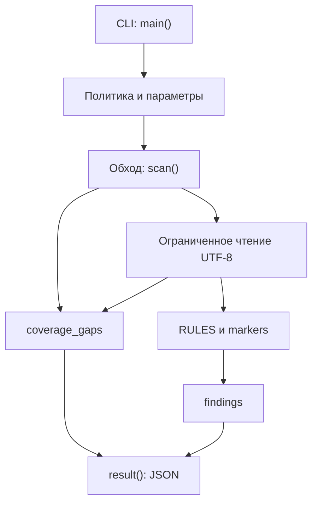

# Архитектура реализации

## Компоненты

`main()` разбирает аргументы, читает политику и проверяет форму `markers`. `scan()` получает каталог, маркеры и лимиты; `private_v4()` уточняет адресные совпадения; `result()` формирует отчёт. Ядро пока находится в одном файле `guard.py`; плагинной системы и отдельных адаптеров нет.

## Поток данных

1. Корневой путь проверяется: существующий каталог, не symlink. Затем вычисляется абсолютный путь через `resolve()`.
2. `os.walk(..., followlinks=False)` обходит дерево. Имена сортируются; symlink-каталоги удаляются из списка обхода и записываются как пробелы.
3. Каталоги `.git` и `__pycache__` удаляются из списка без отдельного пробела. Каждый встреченный файл увеличивает счётчик, даже неподдерживаемый.
4. Symlink-файлы и неизвестные расширения пропускаются. Поддерживаемый файл открывается с `O_RDONLY`, а при наличии — `O_NOFOLLOW` и `O_NONBLOCK`.
5. `fstat()` проверяет обычный файл. Чтение до `max_bytes + 1` выявляет превышение лимита. NUL отвергается, остальные байты декодируются как UTF-8.
6. Правила и маркеры создают отдельные находки. Номер строки вычисляется подсчётом `\n` до позиции совпадения.
7. Результат сериализуется с `ensure_ascii=False`, `indent=2`; код выхода выбирается с приоритетом находок над пробелами.

## Ошибки и границы доверия

Путь, содержимое файлов и политика недоверенные. Текст не выполняется. Ошибка файла создаёт пробел, но не прерывает остальные файлы. Превышение числа файлов завершает обход. Ошибка корня или политики создаёт другой, короткий объект ошибки.

`O_NOFOLLOW` защищает последний компонент пути на поддерживающей ОС; отсутствие этого флага и конкурентная подмена родительских каталогов ограничивают защиту. Это не полноценная файловая песочница.

## Производительность

Чтение каждого файла ограничено, но отчёт хранится целиком в памяти. Для каждого совпадения подсчитываются предыдущие переводы строк: на тексте с большим числом совпадений это может быть дорого. Точное время, пропускная способность и предельный размер рабочего набора не измерены.

## Направление развития

Планируется отделить загрузчик, чистые проверки и сериализацию, добавить суммарные лимиты и проверку контракта. Это целевая архитектура, а не описание уже существующих модулей. Изменения должны сохранять обнаруженные ошибки в результате и не превращать отсутствие данных в успех.

---

[Оглавление документации](index.md) · [English](../en/architecture.md)
